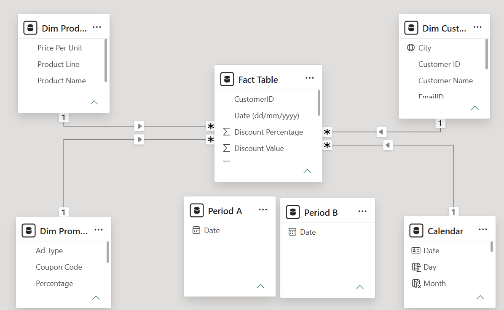
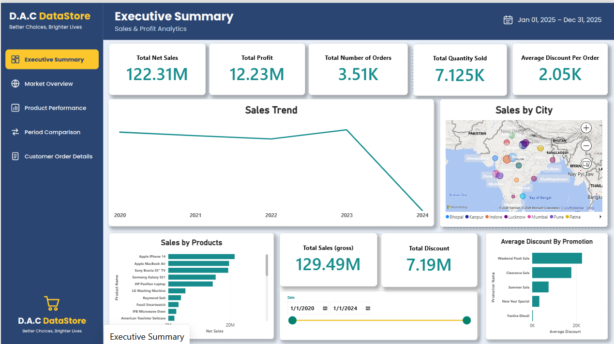
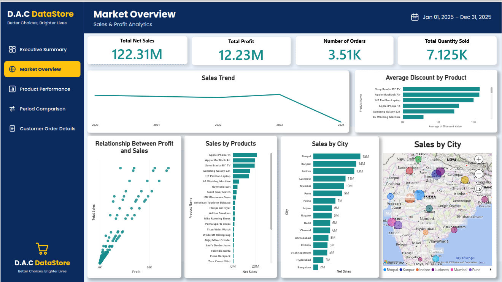
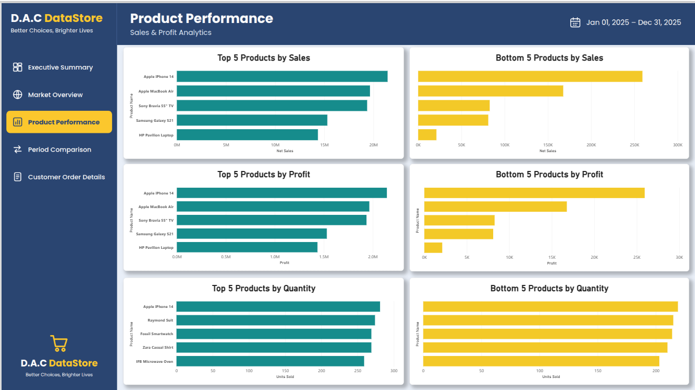
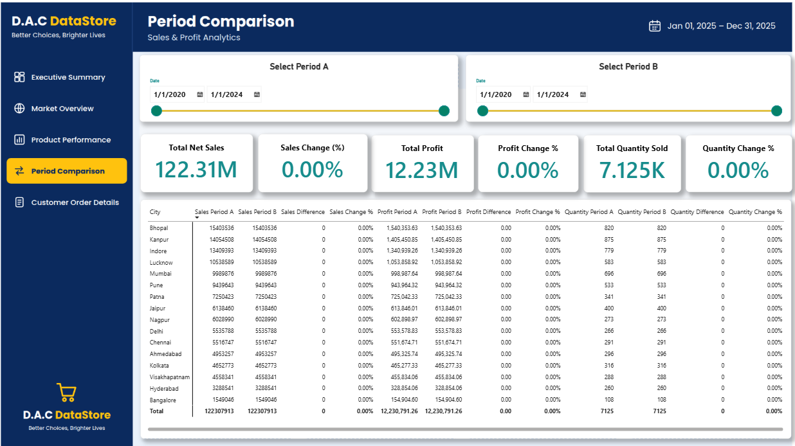
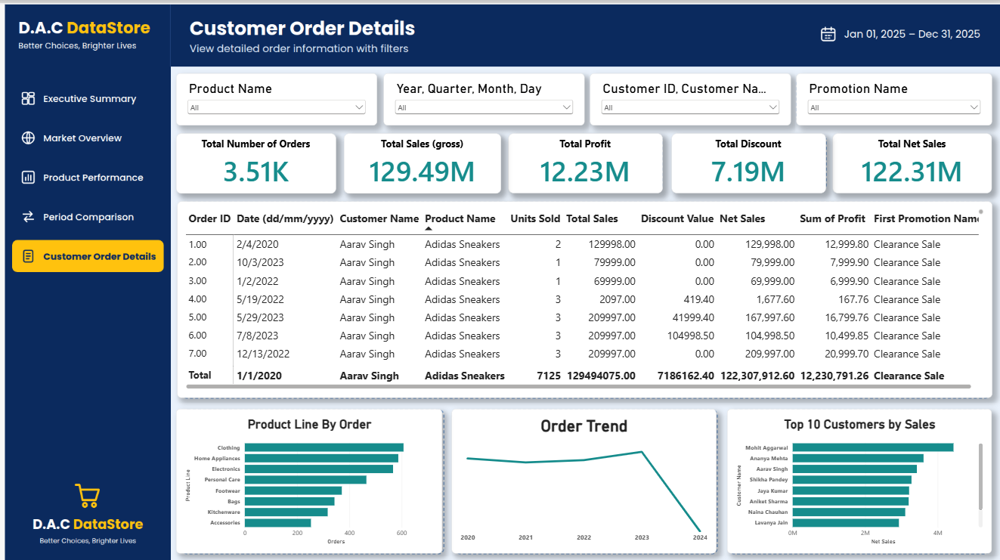

# 🛒 D.A.C DataStore Sales Dashboard
Power BI | Retail Sales Analytics | Project Builders
---
## 🔎 Quick Navigation
[📌 Overview](#-project-overview) •
[🎯 Business Questions](#-business-questions-answered) •
[📊 KPIs](#-key-kpis) •
[🛠️ Tools](#️-tools-used) •
[🧱 Data Model](#-data-model) •
[📈 Dashboard](#-dashboard-preview) •
[💡 Insights](#-key-insights) •
[🚀 Recommendations](#-recomemendations] •
[📝 Data Notes](#-data-notes) •
[📁 Files](#-files-in-repository) •
[✅ Conclusion](#-conclusion)
---
## 📌 Project Overview
The **D.A.C DataStore Sales Dashboard** is an interactive sales analysis and business intelligence report developed in Microsoft Power BI.
D.A.C DataStore is a retail store where customers visit to buy products across eight categories:
**Electronics • Footwear • Clothing • Home Appliances • Accessories • Kitchenware • Bags • Personal Care**
The report brings sales, profit, discounts, customers and cities together in a five-page dashboard. It lets users explore sales trends, product performance, city performance, promotion impact, period-over-period change and order-level detail.
The project was built from a business requirement brief containing eight business questions. Every question is answered by at least one visual in the report.
🌍 Dataset Coverage
Item	Value
Transactions (orders)	3,510
Period covered	01 Jan 2020 – 01 Jan 2024
Products	30
Product categories	8
Customers	50
Cities	16
Promotions	5
---
🎯 Business Questions Answered
#	Business question	Where it is answered
1	What are the Top / Bottom 5 products by Sales, Profit and Quantity Sold?	Product Performance
2	How do sales trends vary over time (daily, monthly, quarterly, annually)?	Executive Summary, Market Overview (drill-down trend), Customer Order Details (order trend)
3	What is the relationship between sales and profit?	Market Overview (scatter chart)
4	How do sales, profit and quantity compare between any two periods chosen by the user?	Period Comparison
5	What is the average discount offered in each discount category?	Executive Summary (average discount by promotion), Market Overview (average discount by product)
6	What is the total number of orders?	Order KPI card on Executive Summary, Market Overview and Customer Order Details
7	What are the sales, profit, discount and net sales of each order, filterable by product, date, customer and promotion?	Customer Order Details
8	What are the sales by city?	Executive Summary (map), Market Overview (map and bar chart)
---
📊 Key KPIs
KPI	Value	Definition
💰 Total Net Sales	122.31M	Total sales after discounts
💵 Total Profit	12.23M	Sum of profit across all orders
🧾 Total Orders	3,510	Distinct order count
📦 Total Quantity Sold	7,125	Total units sold
🛒 Total Sales (gross)	129.49M	Total sales before discounts
🏷️ Total Discount	7.19M	Discount value given, 5.5% of gross sales
📉 Average Discount per Order	2,047	Average discount value across all orders
---
🧰 Tools Used
📊 Microsoft Power BI Desktop
Power BI was used for:
Data modelling (star schema and relationships)
DAX measures (period comparison and totals)
Interactive visuals and drill-down (Year → Quarter → Month → Day)
Slicers and cross-filtering
Multi-page dashboard design with custom navigation
---
🧱 Data Model
The model follows a star schema: one fact table connected to dimension tables, plus two disconnected period tables that power the period comparison.
Table	Role
Fact Table	One row per order: date, customer, product, promotion, units, sales, discount, net sales, profit
Dim Customers	Customer name, city, state
Dim Product	Product name and product line (category)
Dim Promotion	Promotion name, discount percentage, ad type
Calendar	Date table linked to the fact table
Period A / Period B	Disconnected date tables used as the two user-selected comparison periods
Key DAX measures: Total Net Sales, Total Profit, Total Quantity Sold, Sales / Profit / Quantity for Period A and Period B, Difference, and Change %.

---
📈 Dashboard Preview
The report has five pages, navigated from a fixed left-hand menu.
1️⃣ Executive Summary

A one-page overview of the business.
💰 KPI cards: Total Net Sales, Total Profit, Total Quantity Sold, Total Orders, Total Sales, Total Discount, Average Discount per Order
📈 Sales trend with drill-down from year to day
🏆 Sales by product
🌍 Sales by city (map)
🏷️ Average discount by promotion
📅 Date slicer
2️⃣ Market Overview

Where and what customers buy.
💰 KPI cards: Total Net Sales, Total Profit, Total Orders, Total Quantity Sold
📈 Sales trend with drill-down
🌍 Sales by city (map and bar chart)
📦 Sales by product
🏷️ Average discount by product
🔗 Relationship between profit and sales (scatter chart)
3️⃣ Product Performance

🥇 Top 5 products by Sales, Profit and Quantity
🔻 Bottom 5 products by Sales, Profit and Quantity
4️⃣ Period Comparison

Compare any two periods chosen with the Period A and Period B slicers.
📊 Sales, Profit and Quantity change (%)
🧮 Comparison matrix by product, city and promotion showing Period A, Period B, Difference and Change %
> ℹ️ Until both periods are selected there is no change to show. In the screenshot above, Period A is 2022 and Period B is 2023.
5️⃣ Customer Order Details

🔎 Filters: Product, Date, Customer, Promotion
💰 KPI cards: Total Orders, Total Sales, Total Profit, Total Discount, Total Net Sales
🧾 Order-level table (every order with its sales, discount, net sales, profit and promotion)
🛍️ Orders by product line
📈 Order trend
🏆 Top 10 customers by sales
🎛️ Interactive Filters
Users can filter the dashboard by:
📅 Date (year, quarter, month, day)
📦 Product
👤 Customer
🏷️ Promotion
🔁 Period A and Period B (Period Comparison page)
---
💡 Key Insights
🏆 Products
💻 The five Electronics products (iPhone 14, MacBook Air, Sony Bravia TV, Galaxy S21 and HP Pavilion Laptop) generated 73.7% of net sales from only 16% of orders.
🧴 The bottom five products (Colgate, Dove, Nivea, L'Oreal and Tupperware) together contributed just 0.5% of net sales.
📦 Unit sales are almost even across products (203 to 281 units each), so sales rankings are driven by price rather than demand.
🛍️ Personal Care makes up 13% of orders but only 0.3% of net sales.
📈 Trends
📅 Yearly net sales: 31.4M (2020), 30.0M (2021), 28.6M (2022) and 32.3M (2023). After two years of decline, 2023 grew 12.8%.
🍂 October and November are the strongest months, delivering 20% of sales in two months. December, April and May are the weakest.
📆 Tuesday is the strongest day of the week (17% of sales) and Saturday the weakest (12%).
🔁 Period Comparison (2022 vs 2023)
📈 Sales and profit rose 12.8%, quantity rose 9.9% and orders rose 11.6%.
🧾 Net sales per order grew only 1.1%, so growth came from more orders, not larger ones.
💻 Electronics delivered 82% of the net increase. Sony Bravia TV added 3.1M and MacBook Air 1.5M, while iPhone 14 fell by 1.6M (about 24%).
🏷️ Discounts and Promotions
79.5% of orders had no promotion.
Summer Sale (20%) accounts for 59% of all discount value and Weekend Flash Sale (50%) for another 26%.
Clearance Sale (70%) ran in 2023 only and used just 59 orders, yet cost about 1.05M in discounts.
Discounts do not appear to lift basket size: orders average about 2.0 units with or without a promotion.
Electronics absorbs 73% of discount value.
🌍 Cities and Customers
🏙️ Bhopal (15.4M), Kanpur (14.1M) and Indore (13.4M) make up 35% of net sales; the top five cities make up 52%.
👥 City rankings largely follow the number of customers in each city, so city-level conclusions should be read with care.
🤝 The 50 customers place 50 to 83 orders each, and the top 10 account for 27% of sales, so there is no heavy dependence on any single customer.
🔗 Sales vs Profit
Profit equals exactly 10% of net sales on every order, so the relationship is perfectly linear. See the data notes below.
---
## 🚀 Recommendations
💻 Protect the Electronics core. Investigate the iPhone 14 and Galaxy S21 decline in 2023 while backing the products that are growing.
🏷️ Rework promotions. Retire unused offers, test whether a 70% Clearance discount is worth its cost, and target discounts at slow-moving categories rather than Electronics.
🍂 Plan for October and November. Align stock, staffing and marketing with the peak, and look for a campaign to lift December.
🛒 Use Personal Care and Kitchenware as footfall drivers. They bring orders but little revenue, so bundle them with higher-value items.
🏙️ Grow the customer base in the weakest cities. Bangalore (1.5M) and Hyderabad (3.3M) have the fewest customers.
💵 Add product cost data so that true profitability can be analysed.
---
## 📝 Data Notes and Limitations
💵 Profit is a flat 10% of net sales on every order, so profit rankings mirror sales rankings and no margin differences can be analysed. Product cost data would be needed for real profitability.
📅 The dataset ends with a single order on 01 Jan 2024, which is why 2024 appears as a very small final period in yearly views.
🏷️ Orders with no promotion are stored with promotion ID `0`, which has no row in the promotion table, so these orders appear as blank in promotion visuals.
🔢 Amounts are shown without a currency symbol.
🏙️ With 50 customers across 16 cities, city-level results are sensitive to individual customers.
---
📁 Files in Repository
Power BI Dashboard
Business Requirement Brief
Dashboard Screenshots
README
---
✅ Conclusion
The D.A.C DataStore dashboard gives an interactive view of sales, profit, discounts, products, customers and cities, and answers all eight business questions in the brief.
The main findings are that Electronics drives nearly three-quarters of revenue, that 2023 growth came from more orders rather than bigger ones, that October and November are the peak season, and that promotions are not visibly lifting basket size. Adding product cost data would be the most valuable next step.
---
Built by Amaha Genesis Igbang | Data Analyst
<!-- Add your LinkedIn / email links here -->
