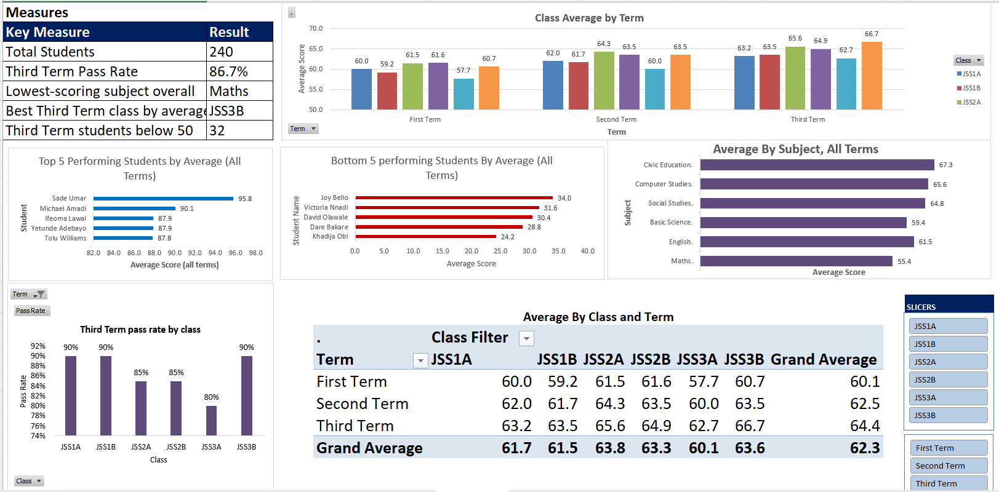
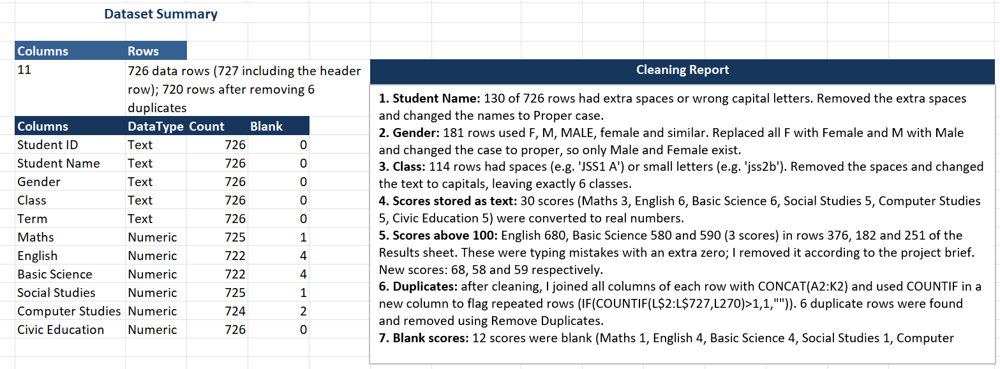
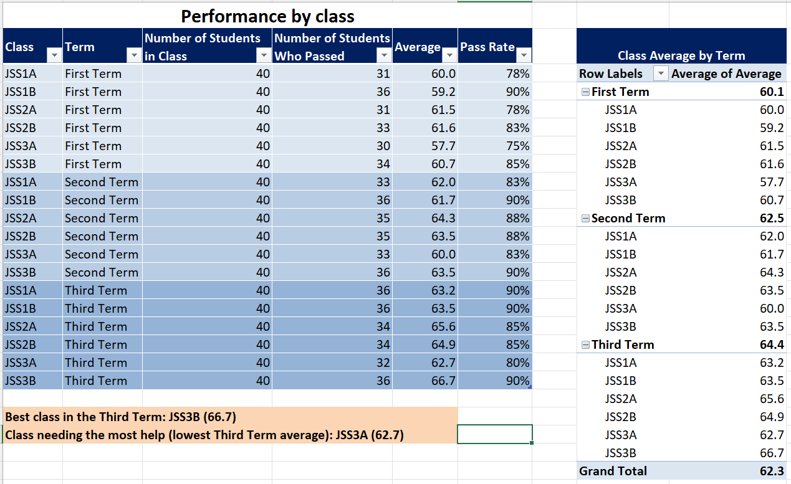
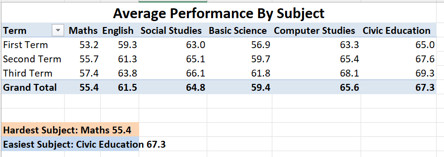
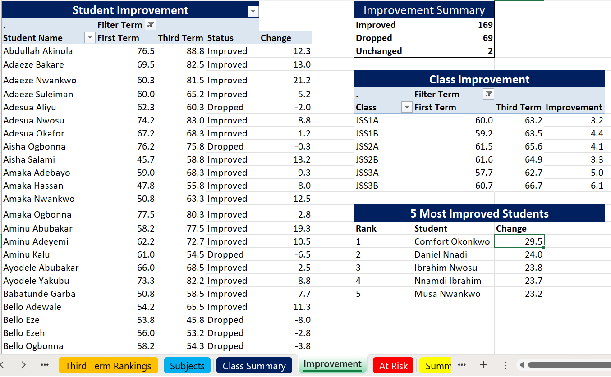
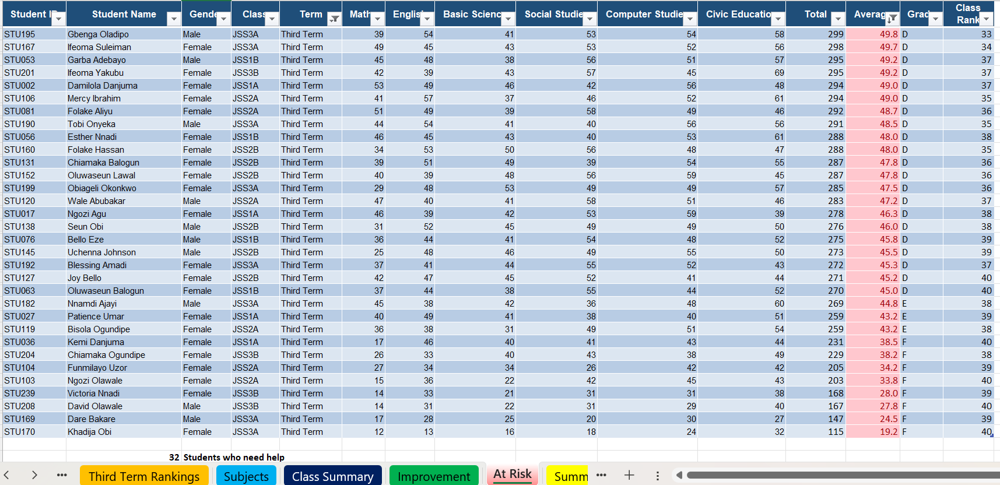
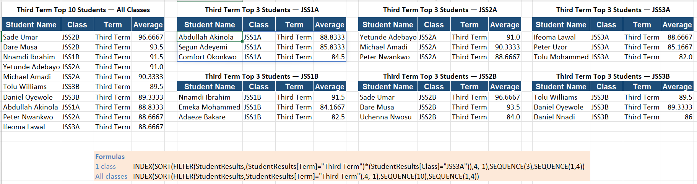

# 🏫 Greenfield School Results Analysis

**Microsoft Excel | Data Cleaning | Educational Analytics | Project Builders**

---

## 🔎 Quick Navigation

[📌 Overview](#-project-overview) •
[🎯 Questions](#-questions-answered) •
[📊 Key Numbers](#-key-numbers) •
[🧰 Tools](#-tools-and-techniques) •
[🧹 Data Cleaning](#-data-cleaning) •
[📚 Workbook](#-workbook-structure) •
[📈 Dashboard](#-dashboard-preview) •
[💡 Insights](#-key-insights) •
[📨 Message](#-message-to-the-principal) •
[🚀 Recommendations](#-recommendations) •
[📝 Data Notes](#-data-notes-and-limitations) •
[📁 Files](#-files-in-repository) •
[✅ Conclusion](#-conclusion)

---

## 📌 Project Overview

**Scenario:** I worked as the data assistant at **Greenfield Secondary School**. The results of all three terms were typed by different teachers into one Excel file, so the data was messy: inconsistent class names, text-formatted scores, impossible scores, blank scores and hidden duplicate rows.

The goal was to **clean the data, answer the principal's questions with formulas, build a one-page summary and advise the principal**.

The raw sheet held **726 rows**. After cleaning and removing duplicates, the final dataset has **720 rows: 240 students × 3 terms**.

### 🌍 Dataset Coverage

| Item | Value |
|---|---|
| Students | 240 (120 male, 120 female) |
| Classes | 6 (JSS1A, JSS1B, JSS2A, JSS2B, JSS3A, JSS3B), 40 students each |
| Terms | 3 (First, Second, Third) |
| Subjects | 6 (Maths, English, Basic Science, Social Studies, Computer Studies, Civic Education) |
| Raw rows | 726 |
| Clean rows | 720 |

### 🏫 School Rules Applied

| Rule | Detail |
|---|---|
| Pass mark | A student passes a term if the average of the subjects is **50 or more** |
| Grade scale | A ≥ 70 • B 60–69 • C 50–59 • D 45–49 • E 40–44 • F < 40 |
| Averages | Exact average used (never rounded); only the display is set to 1 decimal place |
| Blank score | Subject not written: left blank, **not** changed to 0 (skipped by Total and Average) |
| Score above 100 | Typing mistake with an extra zero (780 becomes 78) |
| Duplicates | A student can appear once per term; the second copy is deleted |

---

## 🎯 Questions Answered

The principal wanted answers to four questions. The project answers each one, plus three bonus questions.

| # | Question | Answered in |
|---|---|---|
| 1 | Which class is doing best, and which needs the most help? | **Class Summary**, **Summary** |
| 2 | Which subject is the hardest for students? | **Subjects**, **Summary** |
| 3 | Are students improving from First Term to Third Term? | **Improvement** |
| 4 | Which students need extra support? | **At Risk** |
| B1 | Which class improved the most? | **Bonus** |
| B2 | Average score for each subject in each class | **Bonus** (PivotTable and chart) |
| B3 | Interactive summary with slicers | **Summary** (Class and Term slicers) |

---

## 📊 Key Numbers

| Measure | Result |
|---|---|
| 👥 Total students | 240 |
| ✅ Third Term pass rate | 86.7% (208 of 240) |
| 🏆 Best class (Third Term) | JSS3B, average 66.7 |
| 🆘 Class needing most help | JSS3A, average 62.7 and pass rate 80% |
| 📉 Hardest subject | Maths, average 55.4 across all terms |
| 📈 Easiest subject | Civic Education, average 67.3 |
| ⚠️ Students below 50 (Third Term) | 32 (13.3%) |
| 🔼 Students who improved (First to Third Term) | 169 of 240 (70.4%) |

---

## 🧰 Tools and Techniques

### 📗 Microsoft Excel

- **Data cleaning:** removing extra spaces, proper case, standardising text, converting text to numbers, duplicate detection (CONCAT and COUNTIF) and Remove Duplicates
- **Calculations:** SUM, AVERAGE, IFS (grades), COUNTIFS and AVERAGEIFS (class and term summaries), rank with COUNTIFS
- **Lookups and rankings:** dynamic arrays (SORT, FILTER, SEQUENCE) for the Top 10 and Top 3 lists
- **Excel Tables** with structured references
- **PivotTables, PivotCharts and Slicers** for the interactive summary
- **Conditional formatting** to highlight averages below 50
- **Charts** with titles, axis titles and simple colours

---

## 🧹 Data Cleaning

The original **Results** sheet was left untouched. All cleaning was done on a copy named **Clean Data**.

| Problem found | Rows affected | How it was fixed |
|---|---|---|
| Extra spaces and wrong capitalisation in student names | 130 | Trimmed spaces and applied proper case |
| Gender written as M, F, MALE, female and so on | 181 | Standardised to **Male** and **Female** |
| Class names written in 30 different spellings (e.g. `JSS1 A`, `jss2b`, `Jss3B`) | 114 | Removed spaces and converted to capitals, leaving exactly 6 classes |
| Scores stored as text | 30 | Converted to real numbers |
| Scores above 100 (680, 580, 590) | 3 | Removed the extra zero (68, 58, 59) |
| Blank scores (subject not written) | 12 | **Left blank**, as the school rule requires |
| Duplicate student and term rows, some written differently | 6 | Cleaned first, then the second copy removed |

**Check:** 720 rows • 240 students • 6 classes ✅

---

## 📚 Workbook Structure

| Sheet | Purpose |
|---|---|
| **Results** | Original raw data (untouched) |
| **Clean Data** | Cleaned data with Total, Average, Grade and Class Rank formulas |
| **Cleaning Report** | What was wrong, how many rows, and how it was fixed |
| **Third Term Rankings** | Top 10 students overall and Top 3 in each class |
| **Class Summary** | Students, average and pass rate for each class and term |
| **Subjects** | Average score of each subject by term and overall |
| **Improvement** | First Term vs Third Term for every student, with the 5 most improved |
| **At Risk** | Students with a Third Term average below 50 |
| **Summary** | Key numbers, three charts, slicers and the message to the principal |
| **Bonus** | Class improvement and subject-by-class analysis |

---

## 📈 Dashboard Preview

### 📌 Summary Sheet

The summary sheet contains:

- 🔢 Five key numbers
- 📊 Class average by term
- 📊 Average score of each subject
- 📊 Pass rate by class (Third Term)
- 🎛️ Slicers for Class and Term
- 📨 The message to the principal

### 🧹 Cleaning Report

### 🏫 Class Summary

### 📚 Subjects

### 📈 Improvement

### 🆘 At Risk

### 🏆 Third Term Rankings

---

## 💡 Key Insights

### 🏫 Classes

| Class | First Term | Second Term | Third Term | Change | Third Term pass rate |
|---|---|---|---|---|---|
| JSS3B | 60.7 | 63.5 | **66.7** | +6.05 | 90% |
| JSS2A | 61.5 | 64.3 | 65.6 | +4.08 | 85% |
| JSS2B | 61.6 | 63.5 | 64.9 | +3.35 | 85% |
| JSS1B | 59.2 | 61.7 | 63.5 | +4.35 | 90% |
| JSS1A | 60.0 | 62.0 | 63.2 | +3.16 | 90% |
| JSS3A | 57.7 | 60.0 | **62.7** | +4.99 | 80% |

- 🏆 **JSS3B is the best class** in the Third Term and also improved the most.
- 🆘 **JSS3A needs the most help.** It has the lowest average and pass rate in the Third Term, started lowest in the First Term, and has the most at-risk students (8).
- 📈 Every class improved in every term. The school average rose from 60.1 to 62.5 to 64.4.

### 📚 Subjects

- 📉 **Maths is the hardest subject** in every term (53.2, 55.7 and 57.4), and **62 students (26%) scored below 50 in Maths** in the Third Term.
- 📈 Civic Education is the easiest (67.3 overall).
- All six subjects improved from the First Term to the Third Term.

### 🔼 Improvement

- 169 students improved, 69 dropped and 2 stayed the same.
- The five most improved students are **Comfort Okonkwo (+29.5)**, **Daniel Nnadi (+24.0)**, **Ibrahim Nwosu (+23.8)**, **Nnamdi Ibrahim (+23.7)** and **Musa Nwankwo (+23.2)**.

### 🆘 Students Needing Support

- **32 students (13.3%)** had a Third Term average below 50.
- **25 of the 32 were below 50 in all three terms**, so the problem is persistent rather than new.
- Their weakest subject is Maths (average 34.9).
- The 32 are spread across classes: JSS3A 8, JSS2A 6, JSS2B 6, JSS1A 4, JSS1B 4, JSS3B 4.

### 👧👦 Gender Gap

- In the Third Term, girls averaged **62.9** compared with **66.0** for boys, with pass rates of **81.7%** and **91.7%**.
- **22 of the 32 at-risk students are girls.**
- The gap is widest in English, Social Studies and Computer Studies, and smallest in Maths.

### 🏅 Top Performers (Third Term)

1. Sade Umar (JSS2B): 96.7
2. Dare Musa (JSS2B): 93.5
3. Nnamdi Ibrahim (JSS1B): 91.5

---

## 📨 Message to the Principal

> 1. **JSS3A needs the most help:** it has the lowest Third Term average (62.7) and the lowest pass rate (80%), and 8 of the 32 at-risk students.
> 2. **Maths is the hardest subject** (average 55.4 across all terms), so the school should focus its extra lessons there.
> 3. In the Third Term, **32 of the 240 students (13%) averaged below 50** and need extra support. Most of them were already below 50 in the First Term.
> 4. The overall trend is positive: every class improved each term, 169 of 240 students improved from First to Third Term, and JSS3B rose the most (60.7 to 66.7).
> 5. Before making big decisions, I would like to know whether attendance and assessment difficulty were similar in all three terms, and why girls make up 22 of the 32 at-risk students.

---

## 🚀 Recommendations

1. 🆘 **Start a support plan for JSS3A** and for the 25 students who have been below 50 in all three terms.
2. 📐 **Prioritise Maths:** extra lessons, practice sessions and peer tutoring.
3. 👧 **Investigate the gender gap**, especially in English, Social Studies and Computer Studies.
4. 🔎 **Watch the 25 borderline students** (Third Term average between 50 and 55) before they fall below the pass mark.
5. 📉 **Review the 69 students who dropped** and follow up on the largest drops.
6. 🧪 **Standardise data entry** (drop-down lists for class, gender and term, and numeric-only score cells) so the problems found in this project do not return.

---

## 📝 Data Notes and Limitations

- 🧪 This is an educational project based on a **Project Builders brief**. The student data is simulated.
- 🔢 Averages are **never rounded**; only the display is formatted to one decimal place.
- 🕳️ Twelve blank scores were left blank, so those students' averages are based on the subjects they wrote.
- 🥇 Class Rank uses the exact average, so students with identical averages share the same rank.
- 💻 The Top 10 and Top 3 lists use dynamic array functions (SORT, FILTER, SEQUENCE), which need **Excel 365 or Excel 2021 or later**. PivotTables and slicers need desktop Excel; GitHub cannot show them interactively, so screenshots are included.
- 📊 Results come from one school year of three terms; the gender and class patterns are worth investigating, but they do not by themselves explain the causes.

---

## 📁 Files in Repository

- [Excel Workbook](Greenfield_School_Results_Analysis.xlsx)
- [Dashboard Screenshots](images/)
- [README](README.md)

---

## ✅ Conclusion

This project took messy, hand-typed school results and turned them into clear answers for the principal. After cleaning 726 raw rows to 720 reliable ones, the analysis shows that **JSS3B leads, JSS3A needs the most help, Maths is the hardest subject, and 32 students need extra support, most of them for a long time**.

The overall picture is encouraging: every class and every subject improved from the First Term to the Third Term. The next step is to target support where it is most needed and to understand the gender gap behind the at-risk list.

---

**Built by Amaha Genesis Igbang** | Data Analyst

**LinkedIn:** [Amaha Genesis](https://www.linkedin.com/in/genesisamaha)  | **Email:** [official.amahagenesis@gmail.com](mailto:official.amahagenesis@gmail.com)
